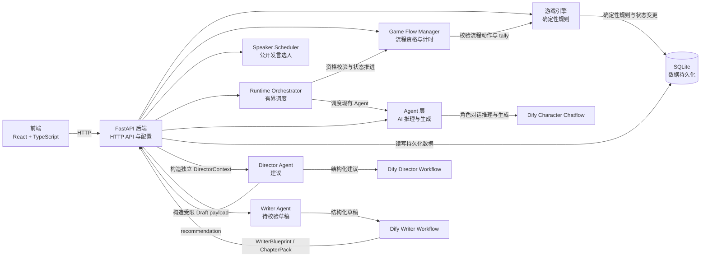
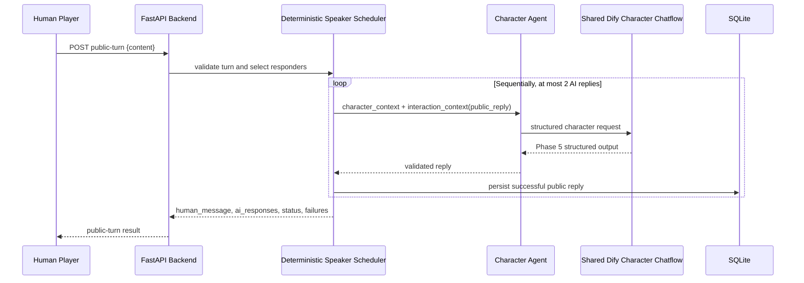
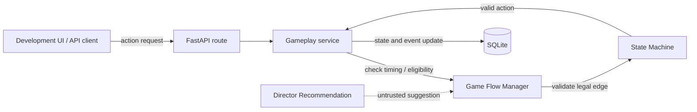
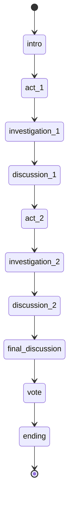
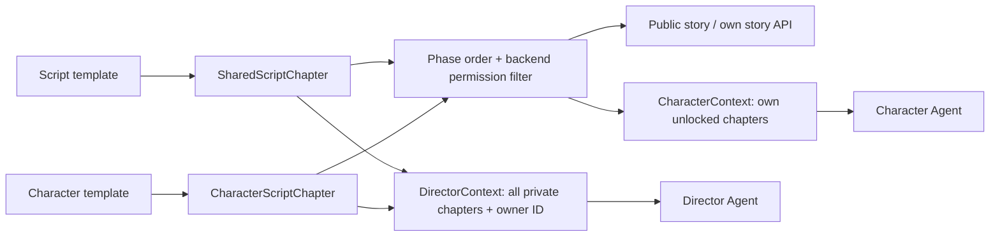
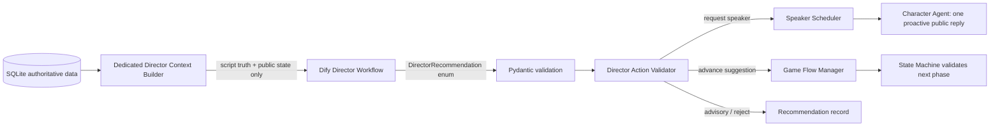
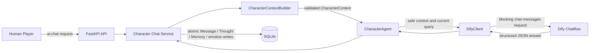
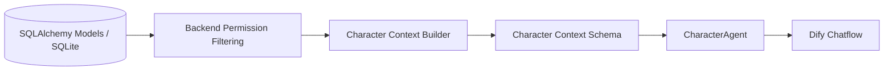
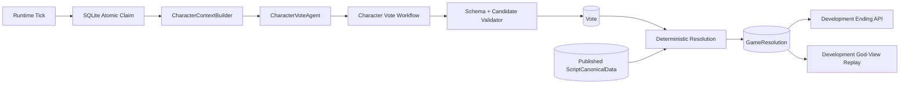

# 架构说明

## 当前系统边界

Phase 3 建立固定阶段转换图、角色搜证与消息 API。Phase 4–5 建立 Character Agent 私聊及结构化状态/记忆。Phase 6 由 Speaker Scheduler 按确定性规则选择公开发言者。Phase 7 增加 Game Flow Manager、阶段计时、确定性投票和独立 Director Workflow；Phase 8B 增加只保存未发布草稿的 Writer Workflow。

## 职责边界

- **Frontend** 展示 Web 界面并调用后端 API，不持有游戏规则或持久化状态。
- **FastAPI Backend** 提供 HTTP 接口，连接前端与服务端各层。
- **Game Engine** 负责确定性游戏规则，是唯一可以校验并应用核心游戏状态变更的层。
- **Game Engine** 负责校验角色选择状态，并锁定一个 human 与三个 ai 的确定性分配。
- **`state_machine.py`** 定义固定的合法 phase transition graph：回答“从当前阶段可以去哪里”。它不负责计时、动作资格或投票。
- **Game Flow Manager** 是确定性流程控制：回答“当前是否允许执行动作”。它计算阶段时间、搜证/讨论/投票/推进资格，协调 State Machine 验证转换，并负责 Vote 校验和确定性 tally。它不调用任何 LLM。
- **Speaker Scheduler** 位于 `backend/app/game/speaker_scheduler.py`，负责对话内的角色发言调度，例如点名匹配、round-robin 与 reaction responder。它与 phase progression、timing 和 vote 是不同领域。
- **Runtime Orchestrator** 位于 `backend/app/services/game_runtime.py`，只决定何时调用现有 Game Flow、Director 与 Character 服务；它不拥有最终状态权威，也不实现第二套规则。
- **Character Agent** 负责单个角色推理与生成，经 Schema 验证返回 speech、inner_os、emotion、intent 和 memory updates；AI 不允许直接修改核心游戏状态。
- **Director Agent** 观察受限的导演视角并生成有限的 `DirectorRecommendation`。它既不是 Game Flow Manager，也不是 Speaker Scheduler；Director 不能写权威状态、改票、推进阶段或直接调用 Character Agent。
- **Writer Agent** 根据明确创作请求生成待验证的 Script Draft。它不能发布正式 Script、改写已存在剧本或修改运行中游戏；输出先经 Schema 和确定性结构检查。
- **Database** 使用 SQLite 持久化脚本模板与游戏运行数据。SQLAlchemy 模型表达真相；Alembic 负责后续表结构迁移，`create_all` 只创建缺失表。
- **Dify Character Chatflow** 生成角色台词；**Dify Director Workflow** 生成导演建议；**Dify Writer Workflow** 生成待校验草稿。三个 Dify App 使用独立 Key 和各自的 Context，均不持有权威游戏状态。

## Multi-Agent Orchestration

“多 Agent”在当前阶段表示后端按回合顺序多次调用同一个 Character Agent 实现，不代表多个独立 Dify 工作流。三个 AI 角色共用同一个 Dify Character Chatflow；每次调用都由后端分别构造 `character_context` 和 `interaction_context`。`interaction_context.mode` 只使用 `private_reply`、`public_reply`、`proactive_public`：分别表示私聊回复、公开回合回复、主动公开发言。权限仍由后端构造 Context 时落实，mode 只说明交互用途，不授予额外信息访问权限。

`POST /api/games/{game_id}/public-turn` 接受 `{ "content": "..." }`，响应含 `human_message`、`ai_responses`、`status`（`completed` 或 `partial`）和 `failures`。`partial` 用于 CharacterAgent/Dify 调用、输出校验或角色回复原子保存失败；Context 构造等未捕获服务错误仍可能返回 HTTP 500。`POST /api/games/{game_id}/ai-step` 仅在 `APP_ENV=development` 开放，用 `proactive_public` 模式触发单个 AI 角色，并返回 `ai_message`。主动 step 使用的 synthetic trigger 是后端编排信号，不是玩家发言，不创建 `Message`。公开消息仍由后端作为实际消息写入；Dify 只生成结构化角色回复，不直接写数据库。

Speaker Scheduler 负责确定性 speaker scheduling；Character Agent 负责单个角色推理与生成；Director 观察整体叙事节奏并提出 recommendation；Writer 生成尚未发布的剧本草稿。四者职责不同。Director 不生成或修改剧本，也不读取 Writer Draft。

## Multi-Agent Failure Semantics

- 私聊 `POST /api/games/{game_id}/ai-chat` 保持整轮 atomic：Dify 成功并通过输出校验后，玩家消息、AI 消息、Thought、Memory 与 emotion 才一起提交；调用或校验失败不留下半轮数据。
- 公开回合先提交 Human Message，再顺序请求角色；每条 AI Message、Thought、Memory 与 emotion 独立原子保存。CharacterAgent/Dify 调用或单条角色回复保存失败时，后端保留此前已提交的消息并以 `partial` 和脱敏 `failures` 报告。Context 构造等未捕获错误可能返回 HTTP 500，但不会撤销此前已提交的消息。`completed` 表示本次请求的步骤均成功完成。
- 主动 step 每次仅请求一个角色。合成触发内容用于说明为何需要主动发言，不会伪装成玩家消息或存为 `Message`。
- 所有角色调用继续使用 Phase 5 的 Structured Output；无效输出不会被持久化为 AI Message。Speaker Scheduler 只协调角色调用顺序，不把 LLM 结果当成权威游戏状态。

## Deterministic Game Engine

Game Engine owns deterministic game truth. 合法阶段转换图位于 `backend/app/game/state_machine.py`；Game Flow Manager 在此图之上计算当前动作资格；数据库操作由 gameplay service 持久化：

流程是：Game Flow Manager 校验该动作在当前流程中是否合格；State Machine 校验转换是否为唯一合法的下一阶段；Gameplay Service 应用通过校验的权威状态变更，并记录公开 system event。API route 只负责 HTTP 请求/响应映射。Director 只能提出建议；后端 deterministic rules 通过校验后才可应用，AI 不直接写入核心游戏状态。

Phase 3 使用固定阶段顺序，不接受客户端提交任意目标阶段。搜证资格由后端依据游戏状态和当前阶段判定；线索从当前 Script 的对应 Act 与地点中稳定选取，并写入 `GameCharacterClue` 记录发现事实。Phase 10 另用 `GameCharacterClueKnowledge` 记录角色通过搜证、私下分享或公开披露知道线索的事实；公开披露不会伪造其他角色的亲自搜证记录。`random_seed` 保留在 GameSession 中，但目前不影响状态推进或线索选择。

## Game Flow Manager 与阶段计时

`GameSession.current_phase` 表示流程节点；`phase_started_at` 表示当前节点开始的服务端时间。整局的 `started_at` 仍只表示游戏启动时刻，两者不可互换。Game Flow Manager 使用集中式 V0.1 timing policy 读取当前阶段的 `minimum_duration_seconds`，根据服务端时间计算经过和剩余秒数。当前开发默认值是除 `ending` 外每阶段 10 秒、`ending` 为 0 秒；规则集中在 `backend/app/game/flow_manager.py`，后续可调整，并不代表最终产品节奏。测试注入当前时间，不需真实等待。此版本不运行后台计时器，页面倒计时只是显示，服务端始终重新计算资格。

State Machine 只回答“这个 phase 是否有下一条合法边”；Flow Manager 同时校验游戏 lifecycle、最短阶段时间、调查/讨论/投票资格和投票完成条件。正式推进顺序为：API 请求 → Flow Manager validation → State Machine transition validation → 保存下一 phase、`phase_started_at` 与事件。Development Manual Advance 仍是单步请求，不能传任意目标 phase。

`GET /api/games/{game_id}/flow` 返回安全 `GameFlowState`，包括生命周期、phase、`phase_started_at`、elapsed、minimum/remaining 时间、`minimum_time_satisfied`、`can_investigate`、`can_discuss`、`can_vote`、`can_advance` 与 `is_finished`。它不返回 culprit 或角色私密资料。投票阶段的玩家安全进度不包含尚未结束的完整票型。

## Deterministic Voting

Vote 是一局中的正式记录。Game Flow Manager 要求游戏为 `in_progress` 且处于 `vote` phase；voter 和 target 都必须属于该局，不能投自己，每名 voter 只能提交一票。V0.1 提交后不能改票；Director 和 Character Agent 没有 Vote 写权限，也不会代替 AI 角色自动投票。

Tally 对同一局所有有效票按 target 计数。最高票唯一时返回该 `winner_game_character_id`；并列最高票时 `is_tie=true` 且 winner 为 `null`。`votes_cast`、`total_voters` 和 `voting_complete` 均由持久化投票记录确定，所有四名角色都投票时才算完成。Director 可在其 context 中看到客观投票进度，但不能增删改 Vote、改变 tally 或挑选平票赢家。完整 tally 仅供 Development 调试。

## Game Lifecycle vs Narrative Phase

`GameSession.status` 表示整局游戏生命周期：

- `waiting_for_character_selection`：等待真人选择角色。
- `ready`：一个 human 与三个 ai 已分配，可以开始。
- `in_progress`：游戏已开始，剧情阶段正在推进。
- `finished`：进入 `ending` 阶段后游戏结束。

旧值 `completed` 与 `abandoned` 暂时保留用于兼容已有数据；Phase 3 新结束流程使用 `finished`。

`GameSession.current_phase` 表示剧情阶段。开始时设为 `intro`，之后仅按以下顺序推进：

进入 `ending` 的同一次推进会同时把 `status` 设为 `finished` 并记录 `ended_at`。`finished` 游戏不再允许推进或搜证。只有 `investigation_1`（线索 `act_1`）和 `investigation_2`（线索 `act_2`）允许搜证。

阶段开始、阶段推进与游戏结束由后端写入固定文案的 system Message；普通消息 API 只能创建 public/private 消息，system 事件不接受客户端输入。

## Information Boundary

游戏信息按可见范围区分：

| 信息范围 | 当前数据示例 | 预期接收者 |
| --- | --- | --- |
| Public Information | Script 的公开元数据、Character 的 `public_background`、已解锁的 `SharedScriptChapter`、已公开线索、公共消息 | 玩家与所有角色 |
| Private Character Information | Character 的 `private_background`、个人目标、对应角色的 `CharacterScriptChapter`、私聊消息及接收对象 | 对应角色或明确获准的接收者 |
| God/Director Information | `is_killer`、角色剧本秘密、核心线索及全局裁定事实 | Game Engine 与 Director；普通角色不接收完整内容 |

当前基础 API 的 `GET /api/scripts` 和 `GET /api/scripts/{script_id}` 只返回 Script 元数据；`GET /api/games/{game_id}` 只返回运行状态、角色姓名和控制类型，不返回角色私密背景、凶手标记、角色运行目标或随机种子。数据库模型中存在更完整的数据，不代表这些字段可以默认向浏览器或角色开放。

私有角色信息还包括 personal_history、relationship_to_victim、pre_case_experience、private_secrets 和 initial_knowledge；这些字段只能加入对应角色的 CharacterContext。God/Director 信息还包括案件真相、规范时间线及 Draft key 到正式数据库 ID 的映射。

普通 Character Agent 不应接收到完整 Script 真相。权限隔离由后端过滤并构造 Context 实现，而不是依靠 Prompt 要求模型保密。

Phase 8C 将完整案件真相、真实时间线、role_key 到 Character ID、clue_key 到 Clue ID 与线索事件关联保存到独立 ScriptCanonicalData。该表只由 Publisher 写入，DirectorContextBuilder 专门读取；CharacterContextBuilder 不查询它，普通 Script/Game API 也不序列化它。

## Script Chapters 与分幕知识权限

Phase 8A 将预设叙事章节与案件真相、运行时认知和正式线索分开保存：

| 数据 | 职责 | 读取范围 |
| --- | --- | --- |
| Script Truth | 现有 Script、Character 的权威设定与凶手标记，以及 Clue 定义 | Game Engine；Director 可见完整内容 |
| `SharedScriptChapter` | 某个 Script 在 `intro`、`act_1` 或 `act_2` 开放的公共叙事 | 玩家与角色仅可读当前已解锁章节；Director 可读全部章节 |
| `CharacterScriptChapter` | 属于一个 Script Character 的预设经历、隐瞒和阶段目标 | 真人与对应 AI 角色只可读自己的已解锁章节；Director 可读全部角色章节 |
| `CharacterMemory` | 单局角色在互动中形成的主观认知，可能正确也可能错误 | 仅该 GameCharacter 的后续 Character Context |
| `CharacterThought` | 一次 AI 回复的私有 `inner_os`、emotion 与 intent | 仅后端及开发专用 Inspector，不进入 Character/Director Context |
| `GameCharacterClue` | 经搜证规则明确授予某个运行角色的正式线索 | 仅获授线索的角色 Context；阅读章节不会创建或授予线索 |
| `GameCharacterClueKnowledge` | 角色当前正式知道的 Canonical Clue 及知识来源 | 该角色、正式分享的目标角色或因公开披露获知的角色 |
| `GameClueDisclosure` | 对已知 Canonical Clue 的一次正式私下分享或公开披露 | 私下披露只对发送者与目标可见；公开披露对全局可见 |
| `GameClueDisclosureAttempt` | 角色提出但未通过校验的结构化披露意图及安全原因码 | 开发审计；不授予线索知识，也不含模型自由文本 |

公共章节通过 `SharedScriptChapter.script_id` 归属 Script；私人章节通过 `CharacterScriptChapter.character_id` 归属角色模板。它们是可复用的剧本内容，不存放在 GameCharacter、Memory、Thought 或 Message 中。同一个 Script 开启多局时，各局共享模板章节，但 Memory、Thought、线索获取和序章确认仍按 GameSession 隔离。

`CharacterContext.shared_script_chapters` 只包含当前已解锁的公共章节；`character_script_chapters` 只包含当前 GameCharacter 所关联模板角色的已解锁私人章节。每项包含章节 ID、顺序、解锁阶段、标题和正文。Builder 根据游戏所属 Script 和当前角色的 Character 关联取数，不接受另一个角色 ID 来扩大权限。CharacterAgent 继续只接收通过 Pydantic 验证的角色专属 Context。

Director 的 `DirectorScriptContext` 包含该 Script 的全部 `shared_script_chapters` 与全部角色的 `character_script_chapters`；每条 Director 私人章节另外带有 `character_id` 以保留所有权。该扩展不把 `CharacterMemory`、`CharacterThought`、inner_os、private Message 或 `current_emotion` 加入 Director Context。两类 Builder 保持分开，Character Context 不提供 `god_mode`。

章节解锁仅接受 `intro`、`act_1`、`act_2` 三个节点，并按 `state_machine.py` 的 `PHASE_SEQUENCE` 判断先后，不比较阶段字符串。游戏 `ready` 且真人角色已选定时，玩家只能读取公共与本人私人 `intro`；进入 `act_1` 后保留 intro 并开放第一幕；进入 `act_2` 后保留此前章节并开放第二幕。更晚阶段仍保留所有已解锁章节。尚未选择角色的游戏不能通过玩家章节 API 暴露剧情正文。

对于含有本人私人 intro 的 Script，GameSession 保存自己的确认时间；真人确认阅读后才能开始游戏。没有私人 intro 的 Phase 0–7 旧 Script 不要求额外确认。确认是本地单人开发模式的流程记录，不证明逐字阅读，也不是用户身份认证。

真人章节 API 依据 GameSession 中唯一 `controller_type=human` 识别角色，不接收调用方提供的 `character_id`。当前没有正式玩家认证，这是本地单人 Development 模式约定；公开部署前必须由真实身份认证和授权替代，不能把 GameSession ID 当作身份凭据。

## Director Information Boundary

Director 使用独立的 `DirectorContext` builder/schema，不复用 `CharacterContext`，也不存在 `god_mode` 参数。它是“知道剧本真相、观察公开局势的导演”，不是能够读取所有角色脑内状态的上帝。

| Director 可以看到 | Director 明确不能看到 |
| --- | --- |
| 当前 Script 元数据、剧本角色定义、`private_background`、个人目标与 `is_killer` | `CharacterThought` / `inner_os` |
| Clue 定义、act、location、核心标志、重要度及客观的角色获得情况 | `CharacterMemory` |
| 当前 GameSession lifecycle、phase、phase timer、可用动作与投票进度 | public/private 以外的所有 private Message，包括 Human ↔ AI 和 AI ↔ AI 私聊 |
| 最近最多 50 条 public/system 消息与公开语音内容 | 角色运行时推理、`current_emotion`、`intent`、Character Agent 原始结构化输出或 Dify prompt 历史 |
| 由后端统计的各角色公开发言次数与最近公开发言时间；最近发言达到 120 秒时标记 inactive | 由某角色私密 Context、Thought 或 Memory 推导的参与度 |

Director 不用角色 Memory 代替事件摘要。当前正式 Script 尚无 canonical truth/timeline 字段；Phase 8B 生成的真相与时间线只保存在独立 Draft，不会被 Director Context 读取。Writer Draft 发布前的真相结构不是正式 Script 权威字段。Director Context 不返回给浏览器，日志也不应记录完整 Context。

## Writer Draft Boundary

Writer 生成的案件蓝图、凶手角色、真实时间线、角色秘密与章节正文保存在独立 `ScriptDraft` 中。Draft 记录的是未发布、尚未完成深层一致性审核的候选内容，不属于正式 `Script`、`Character`、`Clue` 或 Phase 8A 章节表。

| 数据 | Writer 可见 | Character/Director 可见 | 当前权威性 |
| --- | --- | --- | --- |
| `generation_request_json` | 是 | 否 | 用户创作素材，不是游戏状态 |
| `blueprint_json` | 生成后用于续写 | 否 | 待审草稿，包括 draft 内 culprit 与 timeline |
| `chapter_packs_json` | 后续阶段用于连续性 | 否 | 未发布章节草稿 |
| Script / GameSession | 不读取现有运行状态 | 按已有 Context 边界读取 | 由 Game Engine 和正式数据库管理 |

只有 development-only Writer Draft API 和显式标记 **DEVELOPMENT ONLY / SPOILERS** 的 Development 预览可以查看草稿秘密。普通游戏 API、CharacterContext、DirectorContext 不包含 Draft；Writer 也不接收 `CharacterMemory`、`CharacterThought` 或 private Message。Dify 原始输出必须通过严格 Pydantic Schema 和确定性数量、唯一性、枚举及引用校验后才可写入 Draft。JSON 结构校验不代表剧情逻辑没有矛盾；Phase 8C 的独立 Quality Workflow 执行一致性审查，人工批准后才允许发布。

四个生成步骤分别原子认领和保存：Blueprint、Intro、Act 1、Act 2。条件更新避免同一 Draft 同一步并发覆盖；认领事务在请求 Dify 前提交。失败保留已保存步骤，状态记载失败类别和步骤；进程中断留下的 generation lease 超过 10 分钟后可由同一步重新认领。没有后台任务系统或无限自动重试。

Director Workflow 输入为 `director_context` JSON string，经 blocking `/workflows/run` 请求；它与 Character Chatflow 使用独立的 Dify API Key 和 workflow app。Dify 成功响应须为 `data.status=succeeded`，最终 JSON 对象位于 `data.outputs.recommendation`；后端也接受该字段为序列化 JSON string，再进行解析。对象只允许预定义 `pace`、`narrative_risk`、`recommended_action`、`reason` 和 action-specific 引用 ID；Pydantic Schema 禁止额外字段，再由 Action Validator 验证引用与权限。禁止使用 `command` 字符串、动态 dispatch 或 `eval`。

`no_action` 是无副作用成功。`request_ai_speaker` 只有在目标是当前局可发言 AI 且 phase 允许公开发言时，才由后端经 Speaker Scheduler 触发一次 `proactive_public`；不链式触发其他 Agent。`recommend_phase_advance` 交给 Flow Manager 与 State Machine 重新校验 lifecycle、phase timing 和 voting requirements。`suggest_clue_hint` 和 `highlight_public_fact` 只验证引用线索/消息属于当前剧本/游戏，再保存为 advisory，不广播线索或改写消息。无效建议标记 rejected，所有状态修改仍由后端确定性服务执行。

Director 是推荐者，不是 command executor。它不能创建或改变 Vote、决定 tally/tie winner、写阶段状态、变更凶手或改写 Script。Speaker Scheduler 管谁接下来发言；Game Flow Manager 管现在流程是否允许动作；这两个后端确定性领域服务不会把决定权交给 Director。

## Phase 8C Quality Review 与 Script Publication

~~~mermaid
flowchart LR
    Draft[ScriptDraft + revision] --> Validate[Deterministic full-draft validation]
    Validate -->|valid complete input| Quality[Dify Script Quality Workflow]
    Quality --> Report[Strict ScriptReviewReport]
    Report --> Review[Human review and explicit approval]
    Review --> Publish[Atomic Script Publisher]
    Publish --> Tables[Script + Character + Clue + 15 chapters + Canonical Data]
    Tables --> Ready[Script status ready]
~~~

Quality Workflow 的 review 只分析完整 Draft，不能执行修订或写数据库；revise_chapter_pack 只返回 Phase 8B WriterChapterPack，Backend 限定一个 phase 并以 optimistic compare-and-set 更新 Draft。每个 phase 最多两次自动修订；Blueprint、case truth、timeline、角色和线索都不接受自动改写。Quality client 只读独立 DIFY_SCRIPT_QUALITY_API_KEY，不会回退其他 Dify Key。

每条 ScriptReviewRun 绑定 content_revision。修订原子保存 before/after 历史并增加 revision，旧 Review 与 Approval 因版本不匹配失效。Critical/high issues 阻止批准；medium issue 必须逐项被人工明确接受；low issue 可以保留。批准与发布是两次分离的 Development 操作。

Publisher 在单个 SQLite 事务内通过 conditional update claim Draft，再创建一个 Script、四个 Character、线索、三条 SharedScriptChapter、十二条 CharacterScriptChapter 与一条 ScriptCanonicalData。Script 仅在事务内全部创建完成后改为 ready；Draft 通过唯一 published_script_id 保证重复请求返回相同 Script。事务失败时整笔回滚。

Character 的扩展预设字段按角色单独保存，并只加入该角色自己的 CharacterContext；人类角色卡也只返回本局 human 对应模板的扩展资料。ScriptCanonicalData 的真相、时间线和 ID 映射只进 Director 专用 Context，Director Context 继续过滤 private Message、CharacterMemory、CharacterThought 与 inner_os。

Review、Revision、Draft 内容、审批和发布 API 都只在 APP_ENV=development 开放。当前项目尚无玩家身份认证；公开部署前必须补充用户身份与权限控制，不能把 Development 服务直接暴露为公网审核入口。

Quality Workflow 的 Dify 节点、完整 Schema、Prompts、HTTP 契约和 smoke 步骤见 [Dify Script Quality Workflow 配置](dify-script-quality-workflow.md)。

## Phase 9 Runtime Orchestrator

Runtime 由开发页面每 10 秒发送的 bounded Tick 驱动。客户端不在请求未结束时并行发送下一次 Tick；服务端仍以 SQLite conditional update 原子认领，避免多个浏览器或重试同时调度。每次 Tick 只执行一个主要副作用：一条 AI 公开发言，或一次经过 Game Flow Manager 和 State Machine 校验的阶段推进。Director 分析最多处理一条建议，不启动递归 Agent 循环。

Runtime 复用现有 Director Context Builder、Director Agent、Recommendation Apply、Speaker Scheduler、Character Context Builder 和 Character Agent。Runtime 不直接改剧本真相、凶手、投票或角色私有记忆。Director 建议继续经过确定性 Validator；角色发言仍使用本角色权限过滤后的 Context。Dify 超时会结束本次动作并记录安全错误码，不会自动无限重试。

阅读序章、第一幕或第二幕需要玩家确认，且需满足既有最低阶段时长。调查阶段必须由玩家声明结束；普通讨论可由玩家明确准备结束，或由 Director 在最低时长、玩家静默和建议校验均满足时推进；最终讨论只能由玩家明确确认进入投票。Runtime 不代投票，只有四名角色都已投票后 Game Flow 才允许进入结局。Public speech eligibility 仍由现有 Game Flow Manager 统一判定。

## Phase 10 Investigation & Evidence Sharing

Canonical `Clue` 始终来自已发布 Script。Human 搜证 API 由后端解析本局唯一 Human；AI 搜证只由 Runtime 在 `investigation_1` / `investigation_2` 阶段调用相同的确定性搜证服务，每次 Tick 最多一项，每名 AI 每个调查阶段最多一次。位置选择按固定顺序执行，不声称是 LLM 推理。

`GameCharacterClue` 记载角色亲自获得线索；`GameCharacterClueKnowledge` 记载当前角色合法知道哪些线索及来源；`GameClueDisclosure` 记载显式私下分享或公开披露；`Message` 呈现相应交流。线索披露与消息在同一事务提交，唯一约束阻止重复正式事件。普通聊天中的台词不会创建线索或改变已知信息。

CharacterContextBuilder 只向当前角色提供自己搜得、正式分享给自己或已经公开的线索，并分别表达其来源。DirectorContext 只统计搜证与披露状态；它不读取私下披露的消息正文、CharacterMemory、CharacterThought 或 inner_os。角色 Dify 输出增加可选 `clue_disclosure_intent`；后端在同一角色回复事务中验证游戏阶段、来源、线索知识与接收角色，拒绝项只保留不含自由文本的安全原因码。旧的 Phase 5 输出仍可解析。真实 Dify Chatflow 尚未更新时，不能将 AI 正式分享描述为真实云端联调完成。

Runtime state 保存开关、调度水位、冷却时间、claim token 与租约；Runtime Action Log 只保存事件类型、动作、状态、安全 reason code 和关联 ID，不保存 Director/Character Context、私人消息、inner_os 或案件秘密。Runtime status API 只返回安全状态与日志摘要。

Runtime 不运行 Celery、Redis、APScheduler、后台 worker、WebSocket 或 SSE。浏览器关闭后 Tick 会停止，因此不保证后台持续调度；但阶段计时始终依据数据库中的服务端 `phase_started_at`，再次打开页面不会重置时间。接口与开发调试控制仅在 `APP_ENV=development` 开放。操作和恢复细节见 [Game Runtime 说明](game-runtime.md)。

## AI Integration Boundary

当前单角色私聊链路为：

`CharacterContextBuilder` 是唯一负责角色信息过滤的组件。CharacterAgent 接收经过 Pydantic 验证的 `CharacterContext` 和本轮玩家输入，不持有数据库 Session，不访问 ORM；DifyClient 只负责 HTTP、认证、超时和响应解析，不包含剧本或游戏规则。CharacterAgent 把 Dify Answer 解析为 `CharacterModelOutput` 并严格验证，再转换为内部 `CharacterReply`。Dify 请求使用 `DIFY_API_URL` 与 `DIFY_CHARACTER_API_KEY`，配置状态由 `GET /api/ai/status` 提供；该接口只返回是否已配置，不返回密钥。`POST /api/games/{game_id}/ai-chat` 只支持玩家向同局一个 AI 角色私聊。

对话历史仍以 SQLite 中的 `Message` 为准。每次请求均使用新 Dify conversation（`conversation_id` 为空），不把 Dify conversation 当作游戏记忆或权威对话记录。CharacterContext 只包含该目标角色获准看到的消息、已知线索和该角色自己的长期记忆；当前玩家消息单独作为本轮 query 发送。最近 20 条 public/system 与最近 20 条当前角色相关 private 消息进入 Context；Memory 最多 20 条，按 importance、created_at、ID 降序。历史 Thought 不自动进入 Context。

一轮的事务顺序是：校验游戏与目标角色、构造安全 Context、调用 Dify、验证整个结构化输出，然后在同一数据库事务中写入 Human Message、AI speech Message、CharacterThought、去重后的 CharacterMemory updates，并更新 `GameCharacter.current_emotion`。输出验证失败时不写入任何轮次数据；数据库写入失败时整轮回滚。`current_goal` 保持不变。AI intent 只是行为描述，不会触发 Game Engine 动作；AI 不会修改阶段、凶手身份、Script 真相或正式线索。

Chatflow 的 Structured Output 和 System Instruction 用于生成稳定结构与角色行为；它们不是信息安全措施。信息安全来自 Context Builder 限制实际发送的数据，不能靠提示词要求模型保密。不得把 API Key、完整角色 Context 或角色秘密写入日志。

## Character Cognitive State

每轮角色对话中的四类数据各自有明确边界：

| 数据 | 含义 | 权威性与可见范围 |
| --- | --- | --- |
| `Message` | 玩家发送的内容或角色实际说出口的 `speech` | 游戏对话记录；按 public/private channel 授权读取 |
| `CharacterThought` | 某条 AI Message 对应的 `inner_os`、emotion、intent | 角色当轮私有演绎状态；普通消息、游戏状态与 Context 不返回 |
| `CharacterMemory` | 某个 GameCharacter 在某局保留的主观信息 | 角色自己的长期主观认知；仅自己的后续 Context 可见，不等于真相 |
| Game Truth | 当前阶段、凶手身份、Script 真相、线索规则等权威事实 | 由 Game Engine 与数据库确定；不由 AI 输出直接修改 |

`CharacterMemory` 可以保存错误怀疑，例如“Alice 认为 Bob 可能是凶手”，即使 Bob 实际不是凶手。Game Engine 不得依据 Memory 自动裁定或修改真相。Memory 关联到单个 GameSession 和其中的 GameCharacter，同一个 Script 开启新局不会继承另一局的记忆。

`CharacterThought.ai_message_id` 唯一，并通过复合外键保证 Thought、AI Message、GameCharacter 属于同一局且消息发送者就是该 GameCharacter。chat service 另外确认目标由 AI 控制，并以 private AI Message 保存回复。Memory 也通过复合外键约束所属 GameSession/角色与来源消息同局。

普通 AI Chat 响应仅返回 Human Message 与 AI `speech` Message。开发专用 `GET /api/games/{game_id}/characters/{game_character_id}/thoughts` 聚合显示 AI Character 的 current emotion、最新 Thought 和最多 20 条 Memory，只在 `APP_ENV=development` 开放；Development 页面明确标记 **DEBUG ONLY**。这没有构成正式玩家的 OS Replay 功能。

## Character Context Pipeline

- Context Builder 位于 `backend/app/services/character_context.py`，只接收指定 `game_id` 和 `game_character_id`；CharacterAgent 仅使用这一安全 Context 与当前玩家消息生成结构化角色回复。
- Builder 先确认运行角色属于该局，再构造明确的 Pydantic `CharacterContext`；它不会把 ORM 对象交给 Agent。
- 当前角色可获得自己的私密背景、目标和运行状态；其他角色只含姓名、身份与公开背景。
- 公共消息和 system 消息进入公共事件流；private 消息只在当前角色是发送者或接收者，且双方都属于该局时出现。
- system 消息目前没有公开/私有子类型，因此本阶段约定所有 system 消息均为公开旁白。后续 Director 私有消息必须先扩展信息类型后才能保存，不能混入当前 system 流。
- `acquired_clues` 表示当前角色亲自搜得的线索；`known_via_share_clues` 表示因私下分享而知道的线索；`publicly_disclosed_clues` 表示已正式公开的线索。兼容字段 `known_clues` 只汇总当前角色实际知道的线索，后端校验它们属于该局 Script。
- 未被当前角色发现、分享给它或公开披露的线索不会进入其 Context。Actor 对话中的自由文本不创建线索或赋予知识；Director Context 只得到客观线索进度及披露统计，不读私人 Message 正文。
- `memories` 仅读取当前 GameCharacter 在当前 GameSession 中的记录，最多 20 条并按 importance、时间、ID 降序；其他角色 Memory 与任何历史 `inner_os` 都不进入 Context。
- `public_messages` 仅含最近 20 条 public/system 消息；`private_messages` 仅含最近 20 条当前角色发送或接收的 private 消息。两类消息都在 SQL 查询中限量，返回 Context 前按时间正序排列。
- 调试路由只在 `APP_ENV=development` 暴露。角色 Context API 不属于普通游戏前端接口；Character Agent 不直接读取 ORM model，也不直接查询数据库。
- Director 使用与角色 Context 独立的 `DirectorContext` builder/schema；它只读取当前 Script 权威字段与公开/客观游戏状态，不能访问 CharacterThought、CharacterMemory 或 private Message。当前没有完整案件真相字段；Context schema 也不虚构完整真相。

`/api/games/{game_id}/me/character` 当前以本局唯一的 `human` GameCharacter 识别玩家。登录认证尚未实现，因此 GameSession ID 不是用户身份凭据。

## Phase 11 Vote, Resolution & Replay

AI 投票使用独立 `CharacterVoteAgent` 和 Dify Character Vote Workflow，不修改 Character Chatflow。Agent 只能接收由 `CharacterContextBuilder` 构造的当前角色授权信息及三名公开候选人；它不接收其他选票或 DirectorContext。`DIFY_VOTE_API_KEY` 独立配置，不回退 Character、Director、Writer 或 Quality Key。AI 输出经 Pydantic 与候选人白名单校验后，沿用同一 `Vote` 表保存。

只有四名合法角色都投票后才能进入 `ending`。Resolution 在一个数据库事务中绑定 `GameSession`，从发布剧本的 Canonical Truth 读取唯一凶手并核对 Script 中唯一 `is_killer` 角色；AI 输出与发言不影响客观结算。现有 tally 规则在最高票并列时返回 tie，不随机选人。`GameResolution` 的 `game_session_id` 主键保证每局最多一份结果。

Replay 只组合已持久化的 Message、CharacterThought、CharacterMemory、搜证、正式线索披露、Vote 和 Resolution。Thought 通过 `ai_message_id` 对应具体发言；Memory 使用真实创建时间并标记为主观记录。回放不读取模型隐藏推理，也不会将结果送回 Character/Director Context。

由于当前没有登录认证，`/ending` 与完整 `/replay` 仅在 `APP_ENV=development` 暴露。公网部署前必须建立身份验证和 GameSession 访问授权。完整规则见 [投票与结局](voting-and-ending.md)、[God-View Replay](god-view-replay.md) 和 [Character Vote Workflow 配置](dify-character-vote-workflow.md)。
