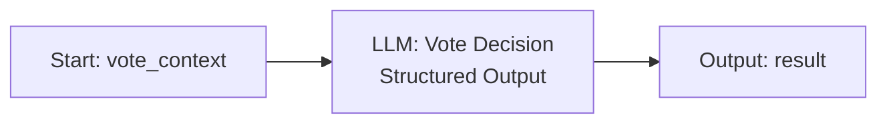

# Character Vote Workflow 配置

本文按当前后端契约配置独立的 Dify Workflow。它只生成一个投票目标和简短角色判断；Game Flow 与 Vote 表仍负责资格校验和正式持久化。

## Dify 应用与节点

在 Dify Studio 新建 **Workflow** 应用，名称使用 `AI Murder Mystery - Character Vote`。不要创建 Chatflow，也不要添加 Agent、工具、知识库、数据库或 HTTP 节点。



Start 的 `vote_context` 是必填文本，内容为后端序列化后的 JSON 字符串。不要在 LLM Prompt 或 Dify 节点中截断该值。当前后端不压缩或截短它；其中已包含当前角色获准看到的章节、最多 20 条本人记忆、最多 20 条相关私聊和最多 20 条公共/系统消息。请为模型选择足以容纳完整输入的上下文窗口。

Vote Decision LLM 使用下方 System Prompt 与 User Prompt，并开启 JSON Structured Output，将 Schema 粘贴到结构化输出配置。Dify LLM 节点的 `structured_output` 必须是 JSON Object。最后 Output 节点新建变量 `result`，类型选 Object/JSON，值选择 Vote Decision LLM 的 `structured_output`。不要选普通 `text`、Markdown 或格式化后的文本。发布后后端会读取 `data.outputs.result`。

## System Prompt

```text
你是 AI Murder Mystery 中一个角色的最终投票决策器。你只负责根据输入的 CharacterVoteContext 选择一名合法的怀疑对象，不负责改动游戏状态。

只依据 vote_context.character_context 和 vote_context.eligible_candidates 中的信息判断。character_context 是当前投票角色经过后端权限过滤后的个人上下文：它可能包含该角色自己的私人章节、私人背景、个人目标、自己的记忆、自己获准读取的消息和自己合法知道的线索。角色可以相信、质疑或误解这些信息；记忆和角色陈述不一定是客观事实。

你可以利用自己的合法角色知识，包括角色在私人章节中对自己行为的认知。即使你扮演凶手，也只能使用当前角色自己的知识；不得因此推断或索取其他角色的私人剧本、记忆、内心 OS 或私聊。

不得要求、猜测或输出案件完整真相、Canonical Truth、凶手字段、Director 判断、其他角色的投票目标或投票理由。输入没有提供的线索和事实不得编造。投票阶段的其他选票彼此保密；本输入不包含投票统计，不要假设任何人已经投给谁。

target_game_character_id 必须逐字选择 eligible_candidates 中某一项的 game_character_id。不能投给自己，不能编造 ID，也不能输出候选名单之外的角色。reason 使用简体中文，最多 500 字，只给简短的角色判断依据，不要输出逐步隐藏推理或 Chain-of-Thought。confidence 是 0 到 1 之间的 JSON 数字。

严格只返回符合 Structured Output Schema 的 JSON Object，不能附带解释、Markdown 代码围栏或额外字段。
```

## User Prompt

```text
请依据下方 CharacterVoteContext，独立完成当前角色的一次正式投票。只从 eligible_candidates 中选择目标，并返回 Schema 要求的 JSON Object。

CharacterVoteContext:
{{#start.vote_context#}}
```

## VoteDecision Schema

此 Schema 对应 `backend/app/schemas/voting.py` 的 `CharacterVoteDecision`。JSON Schema 的可移植部分如下；整数、字符串、数值范围和额外属性策略均与 Pydantic 校验一致。

```json
{
  "type": "object",
  "additionalProperties": false,
  "properties": {
    "target_game_character_id": {
      "type": "integer",
      "exclusiveMinimum": 0
    },
    "reason": {
      "type": "string",
      "minLength": 1,
      "maxLength": 500
    },
    "confidence": {
      "type": "number",
      "minimum": 0,
      "maximum": 1
    }
  },
  "required": [
    "target_game_character_id",
    "reason",
    "confidence"
  ]
}
```

`target_game_character_id`、`reason`、`confidence` 全部必填。Pydantic 额外拒绝非整数 ID、非字符串理由、非数值 confidence 和任何未知字段。后端还会独立检查目标是否属于该次请求的三名候选角色。

## 测试输入与预期输出

在 Dify Test Run 中，为 `vote_context` 粘贴以下完整 JSON 文本。它包含一个当前角色、三名候选人以及该角色获准知道的一条线索；没有 DirectorContext 或案件 Canonical Truth。

```json
{
  "game_id": 77,
  "voter_game_character_id": 42,
  "current_phase": "vote",
  "character_context": {
    "game": {
      "id": 77,
      "status": "in_progress",
      "current_phase": "vote"
    },
    "character": {
      "game_character_id": 42,
      "character_id": 102,
      "name": "许雁",
      "identity": "渡船经营者",
      "public_background": "经营往返港区与旧城区的小型渡船。",
      "private_background": "案发前收到一封没有署名的信。",
      "personality": "冷静，善于观察。",
      "speaking_style": "语气平和，偶尔反问。",
      "personal_goal": "弄清信件是谁送来的。",
      "personal_history": null,
      "relationship_to_victim": null,
      "pre_case_experience": null,
      "private_secrets": [],
      "initial_knowledge": ["暴雨夜渡船停航。"],
      "current_emotion": "suspicious",
      "current_goal": null
    },
    "other_characters": [
      {
        "game_character_id": 41,
        "name": "林澈",
        "identity": "港口档案员",
        "public_background": "负责整理雾港旧仓库的纸本文档。"
      },
      {
        "game_character_id": 43,
        "name": "周序",
        "identity": "修船师傅",
        "public_background": "长期在港口维修小型船只。"
      },
      {
        "game_character_id": 44,
        "name": "叶青",
        "identity": "地方记者",
        "public_background": "正在整理一篇关于港口旧案的报道。"
      }
    ],
    "public_messages": [],
    "private_messages": [],
    "known_clues": [
      {
        "clue_id": 12,
        "name": "未署名信封",
        "description": "一只没有寄件人信息的空信封。",
        "act": "act_2",
        "location": "渡船候船室",
        "is_core": true,
        "importance": 2,
        "discovered_at": null,
        "source": "private_disclosure",
        "knowledge_source": "private_disclosure",
        "first_known_at": "2026-10-15T09:00:00Z",
        "source_game_character_id": 44
      }
    ],
    "acquired_clues": [],
    "known_via_share_clues": [],
    "publicly_disclosed_clues": [],
    "memories": [],
    "shared_script_chapters": [],
    "character_script_chapters": []
  },
  "eligible_candidates": [
    {
      "game_character_id": 41,
      "character_name": "林澈",
      "public_identity": "港口档案员"
    },
    {
      "game_character_id": 43,
      "character_name": "周序",
      "public_identity": "修船师傅"
    },
    {
      "game_character_id": 44,
      "character_name": "叶青",
      "public_identity": "地方记者"
    }
  ]
}
```

目标可以因模型推理而不同，但必须是 `41`、`43`、`44` 之一。一个合规示例输出：

```json
{
  "target_game_character_id": 43,
  "reason": "周序熟悉旧仓库，而我收到的信也提到了那里；我想先追问他对仓库的了解。",
  "confidence": 0.72
}
```

## 后端 HTTP 契约

`VoteWorkflowClient` 使用 blocking Workflow API：

```http
POST {DIFY_API_URL}/workflows/run
Authorization: Bearer {DIFY_VOTE_API_KEY}
Content-Type: application/json
```

请求结构：

```json
{
  "inputs": {
    "vote_context": "<CharacterVoteContext 的 JSON 字符串>"
  },
  "response_mode": "blocking",
  "user": "game-77-voter-42"
}
```

成功响应必须满足 `data.status == "succeeded"`，且 `data.outputs.result` 是 JSON Object。客户端兼容 Dify 将它返回为 JSON 字符串的情况，并在 `CharacterVoteAgent` 中继续执行 Pydantic 校验。没有 `result`、不是 JSON Object、Workflow 失败或请求错误都不会写入选票。代码超时为 60 秒；失败最多重试 3 次，每次至少间隔 30 秒。错误日志只保存安全错误码，不记录上下文或原始模型响应。

## 独立 API Key

发布 Workflow 后，在该 Dify 应用的 API Access 页面生成独立 Key。在项目根目录 `.env` 配置：

```dotenv
DIFY_API_URL=https://api.dify.ai/v1
DIFY_VOTE_API_KEY=填写Character Vote Workflow专用Key
```

不要把 Character、Director、Writer 或 Quality Key 复制到 `DIFY_VOTE_API_KEY`；代码不会做 Key 回退。`.env.example` 只保留空值。保存后重启 FastAPI。`GET /api/ai/vote/status` 只返回 `{"configured": true|false}`，不返回密钥。

## 后端 smoke test

本地数据库升级后，先创建固定开发样例并启动后端：

```bash
cd backend
.venv/bin/python -m app.seed
```

从 `GET /api/scripts` 找到状态为 `ready` 且包含 `ScriptCanonicalData` 的测试剧本 ID。以下命令展示实际路径；所有 ID 都替换为响应中的值。

```bash
curl -sS http://127.0.0.1:8000/api/ai/vote/status
curl -sS http://127.0.0.1:8000/api/scripts
curl -sS -X POST http://127.0.0.1:8000/api/games \
  -H 'Content-Type: application/json' \
  -d '{"script_id":SCRIPT_ID}'
curl -sS -X POST http://127.0.0.1:8000/api/games/GAME_ID/select-character \
  -H 'Content-Type: application/json' \
  -d '{"game_character_id":HUMAN_GAME_CHARACTER_ID}'
curl -sS -X POST http://127.0.0.1:8000/api/games/GAME_ID/me/acknowledge-intro
curl -sS -X POST http://127.0.0.1:8000/api/games/GAME_ID/start
curl -sS -X POST http://127.0.0.1:8000/api/games/GAME_ID/runtime/start
```

通过 Development 页面按顺序推进到 `vote`（每阶段最短 10 秒，序章先确认阅读）。真人选票仍使用现有接口；进入投票阶段后，一个 Runtime Tick 最多调用一次 Character Vote Workflow：

```bash
curl -sS -X POST http://127.0.0.1:8000/api/games/GAME_ID/votes \
  -H 'Content-Type: application/json' \
  -d '{"voter_game_character_id":HUMAN_GAME_CHARACTER_ID,"target_game_character_id":AI_GAME_CHARACTER_ID}'
curl -sS -X POST http://127.0.0.1:8000/api/games/GAME_ID/runtime/tick
curl -sS http://127.0.0.1:8000/api/games/GAME_ID/vote/status
```

重复 Tick 逐一处理剩余 AI。`RuntimeStepResult.action_type` 为 `ai_vote` 且 `vote_id` 非空，证明一张经过后端校验的正式 AI 选票已保存。再等待投票阶段的 10 秒下限，并 Tick 一次进入 ending。最后读取结局和回放，检查四张票及 AI 理由：

```bash
curl -sS http://127.0.0.1:8000/api/games/GAME_ID/ending
curl -sS http://127.0.0.1:8000/api/games/GAME_ID/replay
```

`/ending` 与 `/replay` 仅在 `APP_ENV=development` 且游戏已有正式 Resolution 时可读。不要在现有游戏上做验收；单独创建一局测试 GameSession。真实 Dify 验收必须看到实际 Workflow 请求成功、`vote_id` 已写入、最终 Ending 中有对应的 AI 选票和非空理由。Mock 测试通过不能标记为 Real Vote Dify Smoke Passed。

## 故障定位

| 现象 | 后端行为与检查 |
| --- | --- |
| `configured=false` / `vote_workflow_not_configured` | 检查 `.env` 中 `DIFY_API_URL` 和独立的 `DIFY_VOTE_API_KEY`，然后重启 FastAPI。 |
| Dify 401/403 | Key 无效、被撤销或不属于已发布的 Character Vote Workflow。 |
| Dify 404 | 检查 `DIFY_API_URL` 是否包含 `/v1`，确认 Workflow API 路径和应用可用。 |
| 超时 | 当前请求上限 60 秒；检查 Dify 运行记录、代理与模型服务。失败不会生成假票，Runtime 最多三次受控重试。 |
| Workflow failed、缺少 `result`、JSON 格式错误 | 检查 LLM Structured Output 与 Output 节点映射；最终必须映射到 `data.outputs.result`。 |
| `vote_invalid_output` | 检查三个必填字段、严格 JSON 类型、长度/范围及是否多出字段。 |
| `vote_invalid_candidate` | 模型目标不在本次 `eligible_candidates`，或试图投给自己；该票不会落库。 |
| `ai_vote_conflict` | 该角色已完成投票、并发操作先提交，或游戏阶段已改变；不应再重复创建另一票。 |
| `ai_vote_retry_wait` / `ai_vote_retry_limit` | 前一请求失败，等待 30 秒或已达到每角色 3 次上限；不会无限消耗 Dify 配额。 |
| Ending 返回 409 | 投票未完整、案件 Canonical Truth 缺失/无效或游戏还没有正式结束。检查后端状态，不要手动补票。 |

普通错误响应和 Runtime Action Log 不包含 CharacterContext、案件真相、API Key、私聊或模型原始响应。
