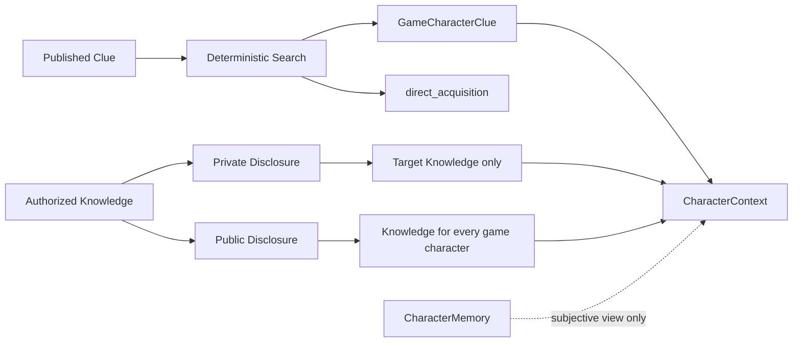

# Phase 10：搜证与线索共享

本阶段复用 Script 已发布的 `Clue` 作为唯一权威线索定义。自由聊天、Character Agent 输出和 Memory 都不能创建或修改 Canonical Clue。

## 五个不同概念

| 概念 | 数据来源 | 含义 |
| --- | --- | --- |
| Clue Definition | `Clue` | 已发布 Script 的权威线索正文、幕次与地点 |
| Clue Acquisition | `GameCharacterClue` | 某个角色在本局亲自搜到线索 |
| Clue Knowledge | `GameCharacterClueKnowledge` | 某角色当前知道线索，并记录首次获知来源 |
| Clue Disclosure | `GameClueDisclosure` | 角色显式向一个对象或全体披露已知线索 |
| CharacterMemory | `CharacterMemory` | 角色对对话与证据形成的主观认知，不是游戏事实 |

直接搜证会同时写 Acquisition 和 `direct_acquisition` Knowledge。私下分享写一个 private Disclosure、private Message 和接收者的 `private_disclosure` Knowledge。公开线索写 public Disclosure、public Message，并为本局角色补充 `public_disclosure` Knowledge；这不会伪造任何人的 Acquisition。

## 调查

`GET /api/games/{game_id}/investigation/locations` 只列当前调查幕的预设位置，不返回线索标题或正文。`POST /api/games/{game_id}/investigation/search` 只接受地点；后端从本局唯一 Human 控制角色确定搜证者。为兼容旧开发请求，旧的 `game_character_id` 如果仍传入，只作为必须匹配 Human ID 的断言，不能选择或冒充角色。

调查只允许 `investigation_1 → act_1` 和 `investigation_2 → act_2`。每次按 importance 降序、Clue ID 升序，在该地点选择该角色尚未直接获得的一条线索；每次最多一条。相同角色重复搜索不会增加 Acquisition；没有剩余线索返回 `found=false`。位置搜证是确定性规则，不用随机数或 LLM 改变剧本事实。

Runtime 的 AI 搜证也调用同一服务：角色按 GameCharacter ID 顺序，每名 AI 每个调查阶段最多执行一次；每次 Tick 最多一个 AI 搜证动作。若玩家已标记该阶段准备结束，Runtime 优先执行原有阶段结束规则。AI 位置由服务在本幕位置名排序后确定性选择，不调用 Dify。

## 知识与披露 API

- `GET /api/games/{game_id}/me/clues` 返回 Human 亲自获得、私下收到和已经公开的线索，三个列表互相区分。
- `GET /api/games/{game_id}/clues/public` 只返回本局已正式公开的 Canonical Clue。
- `GET /api/games/{game_id}/clues/events` 返回公开事件、Human 自己的搜证和涉及 Human 的私人分享，不返回 AI 之间的私下分享。
- `POST /api/games/{game_id}/clues/share` 接收 `clue_id`、`visibility`、可选目标及 `client_request_id`；来源固定由后端解析为本局 Human，不接受 source ID。

private disclosure 必须指向本局另一名 AI 角色；public disclosure 不设单一目标。分享前后端都会核验 Clue 属于本局 Script、来源角色确知线索、当前生命周期/阶段符合要求、目标合法。公开披露只在 `can_public_speak` 允许的阶段执行；私下披露只要求游戏正在进行，沿用现有 private chat 的阶段范围。

同一 client request ID 重放会返回原披露记录。同一角色对同一线索和同一目标的重复私下分享，以及同一局对同一线索的重复首次公开，受 SQLite 唯一约束保护。Message、Disclosure 和新增 Knowledge 同一事务提交；任何校验或写入失败都不会保留半条正式披露。

## AI 正式披露

Character Chatflow 可选返回 `clue_disclosure_intent`。后端只在 AI 真正知道相应 Clue、目标属于本局、阶段允许时执行；自然语言 speech 不会代替结构化动作。非法但 Schema 有效的意图会记录无正文的 `GameClueDisclosureAttempt` 与安全 reason code，不产生 Disclosure 或知识授予。

一次角色回复最多包含一个披露意图。AI 正式披露 Message、Disclosure、Knowledge、原 AI speech、Thought 与 Memory 在同一数据库事务提交。重复正式披露不会重复创建 Disclosure 或正式披露消息。

云端 Character Chatflow 不会由本地代码自动更新。完成本地兼容后，按 [Character Evidence 更新教程](dify-character-evidence-update.md) 手动更新和发布；此前旧结构化输出继续可用，但真实 AI clue disclosure smoke 不能算通过。

## Context 权限

CharacterContext 使用 `acquired_clues`、`known_via_share_clues`、`publicly_disclosed_clues` 三组来源明确的列表，并保留 `known_clues` 兼容现有 Chatflow。Context 只读取当前角色的 Knowledge、当前阶段已公开的线索和已解锁章节；不会读取其他角色的直接获得线索或私人分享，也不会读取 ScriptCanonicalData、其他人的 Memory、Thought 或 `inner_os`。

DirectorContext 可读取完整 Script Truth、Canonical Clue 与客观 Acquisition。它只读取 public/system Message；线索进度可包含公开状态及私下披露次数汇总，不包含私下分享的对象、正文或角色内心信息。公开披露消息作为正式公共事实可被 Director 与所有 Character Context 阅读。

## Runtime 事件、并发与本地安全范围

Runtime 使用 public Disclosure ID 水位与原有 Tick claim、事件日志唯一键、冷却时间及阶段 CAS 去重。private Disclosure 不触发 Director，也不会让 Director 得到 private Message 正文。搜证插入通过数据库唯一冲突处理并在搜证事务中写 Knowledge；披露依赖游戏阶段写锁、client request ID 和唯一索引处理重放/并发。

当前项目没有正式登录认证。`/me` 表示 Development 本地模式中 GameSession 唯一 Human 角色，不是公网身份授权。公开部署前需要独立身份系统，但不属于本阶段。
