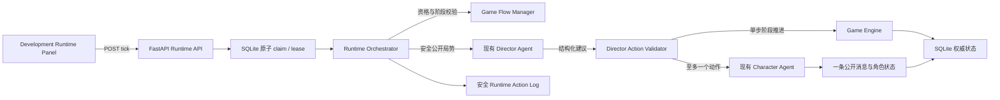

# Phase 9：Game Runtime

## 目标与边界

Runtime Orchestrator 在玩家打开 Development 页面时，按有界 Tick 协调已有 Game Flow、Director、Speaker Scheduler 和 Character 服务。它只负责调度，不拥有最终游戏状态。



Runtime 不创建新 Agent 或 Dify Workflow，不直接改凶手、Script Truth、Canonical Timeline、角色 Memory、Vote tally 或跨角色私人信息。Director 建议仍需通过既有 Validator；阶段推进仍调用 `advance_game_phase`，因此只能走 State Machine 中唯一合法的下一阶段。

## 触发与 Tick 限制

开发页面默认每 10 秒发出一次 Runtime Tick。每个 GameSession 由 SQLite conditional update 原子认领；同一局有另一个有效 claim 时，后续 Tick 返回 `concurrent_tick_conflict`。数据库写事务会在外部 Dify 调用前提交，不会在 HTTP 请求期间持有长事务。

一次 Tick 最多产生一个主要游戏动作：一条 AI 主动公开发言，或一次阶段推进。Tick 调用 Director 后可以处理至多一条经过校验的建议，不会再递归调用 Director 或触发第二名 AI。读取 `GET /runtime` 没有副作用。

Director 分析只由以下候选事件触发：相关阶段首次进入、出现新真人公开消息、当前讨论阶段达到一次真人静默检查。相同阶段水位和 Human Message ID 会去重；private Message、CharacterMemory、CharacterThought 不触发 Director，也不会被放进 DirectorContext。

| 策略 | V0.1 默认值 | 后端位置 |
| --- | ---: | --- |
| Director 分析冷却 | 50 秒 | `backend/app/game/runtime_policy.py` |
| AI 主动发言冷却 | 60 秒 | `backend/app/game/runtime_policy.py` |
| 真人静默阈值 | 60 秒 | `backend/app/game/runtime_policy.py` |
| 前端 Tick 间隔 | 10 秒 | Runtime Control Panel |
| Runtime action lease | 240 秒 | `backend/app/game/runtime_policy.py` |

每个事件的首次处理结果会持久化；Dify 失败不自动重试同一个事件，避免持续请求和重复成本。新的公开消息或阶段事件可以再次触发调度。租约过期后，下一次 Tick 可认领该局并标记旧的 processing 日志为 `lease_expired`；旧 claim token 无法完成新动作。

## 阶段与玩家准备

阶段顺序仍是 `intro → act_1 → investigation_1 → discussion_1 → act_2 → investigation_2 → discussion_2 → final_discussion → vote → ending`。

| 阶段 | Runtime 自动规则 |
| --- | --- |
| `intro`、`act_1`、`act_2` | 先显示当前已解锁的公共与真人私人章节。需要玩家确认已阅读，并满足 Game Flow 最低阶段时长，才推进。Intro 复用 `human_intro_acknowledged_at`；Act 1/2 各有一个幂等确认记录。 |
| `investigation_1`、`investigation_2` | 不会因超时或 Director 建议强制结束。玩家点击“结束搜证并继续”后，满足最低时长才推进。搜证仍由既有规则处理。 |
| `discussion_1`、`discussion_2` | 玩家明确准备结束且满足最低时长时推进；否则只有 Director 建议推进、阶段最低时长满足、真人至少 60 秒无公开发言且建议仍对应当前阶段时，才自动推进。 |
| `final_discussion` | 必须由玩家确认“准备进入投票”并满足最低时长。Director 的 phase-advance 建议只记为 advisory。 |
| `vote` | 不触发 AI 公开发言，不伪造 AI 选票。四名角色已投票且满足 Game Flow 条件后，Runtime 才可推进到 `ending`。 |

在 `investigation_1` / `investigation_2`，Runtime 会在玩家尚未标记准备结束时，按确定性角色顺序执行一项 AI 搜证；同一个 Tick 不会同时搜证并推进阶段。上限由 `RuntimePolicy.ai_investigations_per_character_per_phase` 控制，默认每名 AI 每阶段一次。AI 选择第一个仍有未发现线索的合法地点；没有可调查线索时也会记录一次安全动作，避免重复空跑。玩家标记 Ready 后，Runtime 只按原规则校验时长并推进，不再继续 AI 搜证。Runtime 暂停或阶段变化后，旧 claim 不能提交搜证。

新公开线索披露会形成 `public-clue-disclosure:{id}` Director 事件；Runtime 保存披露 ID 水位并使用原有冷却与 claim 机制，避免每个 Tick 重复分析同一披露。首次进入新阶段会一并消费已有披露水位，避免重复触发。私下分享不生成 Director 事件，也不会把 private Message 正文放入 DirectorContext。

公共发言入口继续使用 Game Flow Manager 的 `can_public_speak` 规则。Runtime 主动发言必须针对本局 AI GameCharacter、通过 Speaker Scheduler 目标校验、满足真人静默和 AI 发言冷却。Character Context Builder 只提供该角色获准读取的信息。AI 回复过程中若游戏阶段改变，保存前会再次做阶段与 claim 检查，迟到的公开回复会被丢弃。

## API

所有 Runtime API 仅在 `APP_ENV=development` 开放，当前项目没有正式登录认证。

| 方法与路径 | 用途 |
| --- | --- |
| `GET /api/games/{game_id}/runtime` | 读取状态与最近安全动作日志，不创建状态、不触发 AI。 |
| `POST /api/games/{game_id}/runtime/start` | 为已开始的 GameSession 启用 Tick 调度。 |
| `POST /api/games/{game_id}/runtime/pause` | 阻止新 Tick 动作认领；已认领的动作可以完成。 |
| `POST /api/games/{game_id}/runtime/tick` | 尝试认领并运行一次有界调度。 |
| `POST /api/games/{game_id}/runtime/acknowledge-phase` | 只确认当前 `intro`、`act_1` 或 `act_2`。请求不接受客户端指定未来阶段。 |
| `POST /api/games/{game_id}/runtime/ready` | 为当前调查、讨论或最终讨论记录真人准备状态。 |

Tick 响应用 `action_type`、`execution_status`、阶段前后值和安全 `reason_code` 表示结果，不返回 Director reason、模型上下文或剧本秘密。Runtime 状态返回最多 10 条动作摘要，不包含 event key、claim token、完整 Context 或 Message 正文。

## SQLite 状态、日志与错误恢复

`GameRuntimeState` 保存开关、时间戳、水位、ready 标记、claim token、租约与安全错误码。`GamePhaseAcknowledgement` 对同一局的 Act 1/Act 2 确认提供唯一约束。`GameRuntimeActionLog` 以 `(game_session_id, event_key)` 唯一键去重，并只保存动作摘要与关联记录 ID。Director Recommendation 新增来源 phase、`phase_started_at` 和最新公开消息水位，用于拒绝过期建议。

Phase 9 migration 是 `20261012_phase9_runtime`，升级前需备份真实开发数据库并运行：

```bash
alembic -c backend/alembic.ini upgrade head
alembic -c backend/alembic.ini current
```

应用启动时 `Base.metadata.create_all()` 只补建缺失表，不会替已有表增加列，因此不能代替 Alembic。迁移没有删除或重建既有游戏、消息、Memory、Thought、Vote、ScriptDraft、ReviewRun、RevisionRecord 或 CanonicalData。

Runtime 将已知 Dify 错误转换为安全 reason code，例如 `director_timeout`、`director_not_configured`、`character_timeout`、`character_output_invalid`。错误响应和日志不包含 API Key、原始模型错误正文、DirectorContext、CharacterContext、inner_os、私人消息或 Script Truth。对某个事件的失败不会无限重试；页面可显示状态并由玩家继续公开交流、搜证、Ready 或手动暂停。

## Phase 11 AI 投票

在 `vote` 阶段 Runtime 不安排 Director 分析、搜证或公开发言，而按 `GameCharacter.id` 顺序选出一名未投票 AI，执行一项独立 Vote Workflow 动作。每个 Tick 最多生成一张选票；Human 只能通过 Human Vote API 投票。Vote Workflow 失败不会伪造目标，重试最多三次、间隔至少 30 秒。

投票 Context 使用同一 `CharacterContextBuilder`，并增加三名公开候选人；不传真实案件真相、DirectorContext 或他人选票。选票通过后复用 `Vote` 表和每局每角色唯一约束。Runtime 只有在 Human 与三个 AI 都已提交合法选票后才允许 `vote → ending`。此转移与 GameResolution 和 system ending 消息在同一事务中保存。

进入 ending 后 GameSession 为 `finished`，后续 Runtime Tick 返回 `game_finished`，不再调度 AI 或 Director。Vote Workflow 配置见 [Dify Character Vote Workflow](dify-character-vote-workflow.md)，结算规则见 [投票与结局](voting-and-ending.md)。

## 浏览器关闭与权限

V0.1 没有 Celery、Redis、APScheduler、WebSocket、SSE 或常驻后台 worker。页面关闭时客户端 Tick 停止，Runtime 不保证继续自主运行；游戏阶段计时仍按数据库中的服务端 `phase_started_at` 计算，页面重新打开不会重置时间。重新打开 Development 页面会重新读取服务器状态。

Runtime status 与日志都不包含私人运行时内容。Director 仍通过独立 DirectorContextBuilder 获得公开局势与其被授权的剧本信息；Character 仍通过当前 GameCharacter 的 CharacterContext 获得角色自己的信息。Runtime 不构造额外的信息通道。
