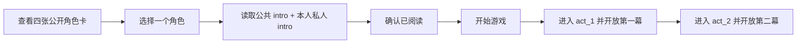
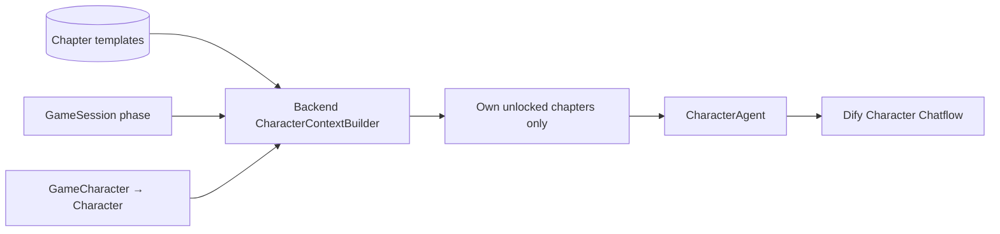

# 剧本章节内容设计

Phase 8A 为游戏加入可阅读的公共故事和角色私人剧本章节。章节属于可复用的 Script / Character 模板；每局只保存当前进度与阅读确认，不复制或改写章节正文。

## 数据边界

| 数据 | 保存位置 | 表达内容 | 不代表什么 |
| --- | --- | --- | --- |
| Script Truth | 现有 Script、Character 和 Clue 权威字段 | 案件事实、角色设定、凶手与预设线索 | 不是自由生成的叙事段落 |
| 公共剧本章节 | `SharedScriptChapter` | 所有玩家与角色在指定阶段可以阅读的共同故事 | 不是公共聊天 Message |
| 私人角色剧本章节 | `CharacterScriptChapter` | 一个 Character 模板的预设经历、隐瞒和阶段目标 | 不是运行角色 GameCharacter 的状态 |
| Memory | `CharacterMemory` | 一局中由角色互动形成的主观认知 | 不保证正确，也不能修改案件事实 |
| Thought | `CharacterThought` | 某次 AI 回复的私有 inner OS、情绪和意图 | 不等同于剧本背景或长期 Memory |
| 正式线索 | `Clue` 与 `GameCharacterClue` | 预设线索及经规则授予某角色的运行时发现 | 阅读章节不会自动授予线索 |

公共章节通过 `script_id` 关联一份 Script。私人章节通过 `character_id` 关联一个属于该 Script 的 Character。后端读取时还会校验游戏、Script 与运行角色之间的关联，避免章节跨剧本或串到其他角色。

## 章节阶段与解锁

第一版只接受三个 `unlock_phase`：`intro`、`act_1`、`act_2`。比较阶段时使用 `state_machine.py` 固定阶段顺序，不使用字符串排序。

| 游戏进度 | 可阅读章节 |
| --- | --- |
| `ready`，真人已选角色 | 公共 intro 与所选角色私人 intro |
| `in_progress` / `intro` | intro |
| `act_1` 至 `act_2` 前 | intro、act_1 |
| `act_2` 及之后 | intro、act_1、act_2 |

后续阶段保留之前已解锁的章节。未选择角色的游戏不能借普通玩家 Story API 读取私人章节，也不能通过章节标题或元数据预览未来内容。`finished` 游戏仍只按当前唯一 Human 角色的权限读取其已解锁私人章节。

序章阅读确认由 GameSession 的时间戳记录。只有被选 Human 对应的私人 intro 章节存在时，开始游戏才要求该局已确认；没有私人 intro 的旧 Script 继续使用原有启动流程。重复确认保持幂等。同一个 Script 创建多局时，每局的确认互不影响。

## 真人阅读流程

真人私人剧本 API 根据 GameSession 中唯一 `controller_type=human` 角色定位，不接受调用方提供 `character_id`。当前项目尚无登录认证；这是本地单人 Development 模式的访问约定，不构成正式身份验证。公开部署前必须加入真实玩家认证与授权。

公共与私人章节以独立 Story API 返回 Pydantic response，不直接序列化 SQLAlchemy ORM。列表仅含已解锁正文。游戏基本状态、角色选择卡和 Script metadata 继续使用显式字段白名单，不附带私人章节或完整 Script Truth。

| 方法 | 路径 | 用途 |
| --- | --- | --- |
| `GET` | `/api/games/{game_id}/story/public` | 读取该局当前已解锁的公共章节 |
| `GET` | `/api/games/{game_id}/me/story` | 读取该局唯一 Human 角色已解锁的私人章节 |
| `POST` | `/api/games/{game_id}/me/acknowledge-intro` | 幂等确认已阅读私人序章 |

API 不接收章节 ID 或角色 ID 作为授权依据。读取范围、ready 状态的 intro 规则和开始前的确认检查均由后端确定。

## Character Agent 知识

Character Agent 继续使用现有 Character Chatflow 与 `CharacterContext`。`character_context.shared_script_chapters` 包含该局当前阶段已解锁的公共章节；`character_context.character_script_chapters` 只包含当前 GameCharacter 对应 Character 模板的已解锁私人章节。每个章节包含 `chapter_id`、`chapter_order`、`unlock_phase`、`title` 和 `content`。

构造顺序为：

Context Builder 不加载未来章节、不查询其他角色私人章节，也不把故事内容写进 Message。普通 Character Context 不包含凶手字段、完整 Director Script Truth、其他角色 Memory、Thought 或 inner OS。系统提示词可以指导角色如何演绎秘密，但真正的权限由后端构造 Context 落实。

角色可以隐瞒或用角色化方式回避自己的私人经历，但只能基于已收到的信息回答。剧本章节是预设背景经历；Memory 是本局形成的主观认知，可能有误；Thought 是单次回复的私人内心状态；正式线索只来自后端搜证授予。四者不能混用。

## Director Context

Director 使用单独的 `DirectorContextBuilder` 和 `DirectorContext`。Director Script Context 可以读取该剧本的全部 `shared_script_chapters` 与全部角色的 `character_script_chapters`；每条私人章节附带 `character_id`，保留来源角色信息。

完整章节可帮助 Director 观察全局叙事是否连贯，但 Director 仍不接收 `CharacterMemory`、`CharacterThought`、inner OS、private Message 或角色运行时情绪。增加章节不会让 Director 获得角色运行时私聊或脑内状态。

## 《雾港档案》开发样例与 Seed

固定开发样例《雾港档案》包含 3 段公共章节和 12 段私人章节，每个角色各有 intro、act_1 与 act_2 一章。内容围绕当前四位角色及既有案情、凶手和三条既有线索展开，不通过 Seed 修改角色、凶手、线索或已有 Script Truth。

运行 `PYTHONPATH=backend python -m app.seed` 时，Seed 只识别标题为固定开发样例的 Script。它按章节顺序检查并补充缺少的样例章节；章节已存在时保留原正文，不覆盖用户编辑，不删除 Script、章节、GameSession 或游戏进度。其他剧本不会被加入样例章节。

## Phase 8B Writer Draft 的边界

Phase 8A 本身不调用 Dify 生成或修订剧本。Phase 8B 在独立 `ScriptDraft` 中生成待校验内容，不写正式 Script、Character、Clue 或 Phase 8A 的公共/私人章节表。

Writer Workflow 通过四步独立调用生成 Blueprint、Intro、Act 1、Act 2。Blueprint 定义案件真相、真实时间线、四名角色和预设线索；Chapter Pack 则含一个公共章节与四个角色章节。草稿内部只使用 `role_key`、`clue_key`、`event_key`，不使用正式数据库 ID。

Backend 使用严格的 Blueprint 与 Chapter Pack Pydantic Schema，另外确定性检查数量、key 唯一性、phase/order、角色覆盖和引用完整性。经过校验的每个步骤会独立保存；失败不会覆盖之前成功的内容。

Writer Context 不读取既有 GameSession 中的角色 Memory、Thought 或 private Message。完整 Draft 只允许 Development-only API 查看，不能流入普通玩家、Character 或 Director Context。结构校验不保证因果逻辑正确；Phase 8C 的独立 Quality Workflow 负责一致性审查，人工批准后才允许正式发布。

完整 Dify Workflow 节点、输入输出契约、JSON Schema 和 Prompt 见 [Dify Writer Workflow 配置](dify-writer-workflow.md)。

## Phase 8C 发布与真相边界

Phase 8C 增加独立 Quality Workflow：它读取完整 Draft 与真相检查结构之外的剧情一致性，Review 结果按内容版本保存；只有章节可被一次性受控修订，Blueprint、真相、时间线、角色和线索保持不变。人工批准当前版本后，Publisher 才在事务内映射正式 Script、Character、Clue、共享/私人章节和 Director 专用 Canonical Data。

角色扩展私密资料随 Character 模板明确存储，但 CharacterContext 只取得当前角色自己的字段。ScriptCanonicalData 不进入 CharacterContext 或普通 Script/Game API；DirectorContext 可以读取其中的 truth 和 timeline，但仍不读取 CharacterMemory、CharacterThought、inner_os 或 private Message。完整 Quality Workflow 契约见 [Dify Script Quality Workflow 配置](dify-script-quality-workflow.md)。
